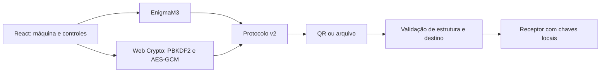

# Enigma M3 × AES-256-GCM

Protótipo educacional para o **Desafio 2 — Comunicação Segura: Enigma × Criptografia Moderna**, Hackathon 2026, Universidade de Vassouras — Campus Maricá.

O problema é demonstrar como duas máquinas trocam mensagens cifradas por um canal que pode ser interceptado, e por que a segurança depende também da gestão de chaves e do protocolo. A solução reúne uma Enigma M3 visual, transmissão por QR Code e um comparativo funcional com AES-256-GCM.

## Executar

Use Node.js 22.12 ou superior compatível com o Vite instalado.

```sh
npm ci
npm run dev -- --host 0.0.0.0
```

No computador, abra o endereço local mostrado pelo Vite. No celular, use o endereço de rede mostrado pelo terminal, com ambos os dispositivos no mesmo Wi-Fi. **Câmera ao vivo e Web Crypto precisam de contexto seguro: HTTPS ou localhost.** HTTP pelo IP da rede não garante essas funcionalidades. Para a demonstração entre aparelhos, use uma hospedagem HTTPS; a galeria também permite ler uma imagem do QR.

```sh
npm test
npm run lint
npm run build
npm run preview
```

## Demonstração em dois aparelhos

1. No remetente, selecione **Esta máquina: Comando Alpha**, destinatário **Submarino U-47** e carregue o **dia 6** na folha de chaves.
2. No receptor, selecione **Esta máquina: Submarino U-47** e carregue também o **dia 6**.
3. Digite nos dois aparelhos a mesma senha compartilhada (qualquer tamanho, desde que não esteja vazia). Combine essa senha por outro canal. Ela fica apenas na memória da aba e não vai no QR.
4. No remetente, escreva `ATAQUE AO AMANHECER`, clique em **Cifrar** e aguarde a preparação do pacote. **Transmitir** mostra o QR.
5. No receptor, clique em **Receber** e aponte a câmera para o QR. Como alternativas, selecione uma imagem do QR na galeria ou cole o JSON de um arquivo `.enigma`.
6. Confira a saída Enigma (`ATAQUEAOAMANHECER`, sem espaços) e o texto AES (`ATAQUE AO AMANHECER`). A Enigma só representa A–Z; o terminal normaliza acentos e remove números e pontuação antes de cifrar.
7. No painel **Prova ao Vivo**, compare chave correta e posição deslocada, troca de rotores ou plugboard incorreto. A prova usa a posição inicial da mensagem, não a posição final após digitar.
8. No remetente, clique em **Adulterar cifra**: o experimento muda uma letra da cifra Enigma e um bit da cifra AES. A Enigma realmente processa a cifra modificada; o AES rejeita a autenticação. Também é possível transmitir o pacote adulterado para o receptor.
9. Limpe a fita para iniciar uma nova transmissão. Alterar rotores, anéis, refletor, conexões ou estação limpa a mensagem anterior, evitando combinar configurações diferentes na mesma fita.

Para configurações manuais, combine os mesmos rotores, anéis, refletor e conexões nos dois aparelhos. A posição inicial pública da mensagem é transportada no protocolo. Um receptor com a chave Enigma errada pode exibir texto ilegível mesmo que o AES esteja correto: são dois experimentos independentes.

## Funcionalidades

- Enigma M3 com rotores I–V, refletor B/C, anéis, posições, avanço duplo e até 10 pares no plugboard.
- Teclado clicável, lâmpadas, rotores visíveis, tampa, texturas e som procedural.
- Cabos arrastáveis com mouse e toque, com conexão por cliques como alternativa. Arrastar uma ponta muda a conexão; soltar fora cancela a mudança.
- Quatro estações: ALPHA, U47, BLETCHLEY e OUTPOST. Destinatário selecionável; a recepção recusa mensagens de outra estação.
- Folha **demonstrativa de cinco dias**: 1, 6, 14, 22 e 30. Configurações fictícias, públicas no código, para fins didáticos.
- QR Code, leitura pela câmera ou imagem, colagem de JSON e exportação `.enigma`.
- AES-256-GCM com IV aleatório de 12 bytes, salt aleatório de 16 bytes, tag de 16 bytes e PBKDF2-SHA256 com 100.000 iterações.
- Cabeçalho e cifra Enigma autenticados como dados adicionais do AES; não é possível alterar remetente, destinatário ou posição sem invalidar a tag.
- Histograma A–Z do original e da cifra, com contagens e percentuais.
- Comparativo de busca exaustiva com taxa e fórmula explícitas; não se apresenta uma estimativa como benchmark medido.
- Rastreador do caminho elétrico e modo Bletchley Park para eliminar alinhamentos impossíveis de palavras prováveis.

## Arquitetura



- `src/core/enigmaEngine.ts`: cifra, avanço e rastreamento da Enigma.
- `src/core/modernCrypto.ts`: derivação, criptografia autenticada e adulteração de bytes.
- `src/core/protocolPayload.ts`: serialização, validação estrita e dados autenticados.
- `src/core/keySheet.ts`: estações e folha de chaves didática.
- `src/App.tsx`: sessão, posição inicial, encaminhamento e operações assíncronas.
- `src/components`: máquina, painéis comparativos e leitores QR.
- `tests/qa_suite.ts`: verificações dos motores e protocolo.

Aplicação estática, sem back-end, contas ou banco de dados. Configurações e senha digitada ficam na memória da aba. Detalhes dos campos, limites, autenticação e modelo de ameaça: [protocolo da mensagem](docs/protocolo.md).

## Tecnologias e ferramentas de IA

React, TypeScript, Vite, Tailwind CSS, SVG, Lucide, Web Crypto API, Web Audio API, `qrcode.react` e `html5-qrcode`.

Ferramentas de IA declaradas pela equipe: **Gemini 3.8, Gemini Argon e Claude Sonnet 5.5** (nomes informados pela equipe). **Codex** foi utilizado na revisão de aderência ao edital, implementação dos cabos arrastáveis, correções do protocolo, interface, testes e documentação. Os integrantes devem compreender e explicar o código e suas decisões na arguição.

## Equipe e divisão de tarefas

| Integrante | Responsabilidades |
| --- | --- |
| Marcos Gabriel Sales Pires | Testes de usuário e correções no projeto |
| Matheus Duarte Louredo da Costa | Prototipagem e entrega do MVP |
| Brenno Fernandes de Aragao | Revisão do README |
| Raphaela Tamara Zille dos Reis | Testes de usuário, prototipagem e entrega do MVP |
| Ravi Carlos Diano da Costa e Dias da Fonseca | Líder e coordenador; revisão do README |

## Verificação e limites

A suíte automatizada cobre reciprocidade, avanço duplo, anéis, plugboard, vetores conhecidos de Enigma, AES com chave correta/incorreta, adulteração, IV e salt, protocolo sem segredos, validação de pacotes e autenticação do cabeçalho. Não substitui o ensaio com câmera física e celular real.

Este é um simulador educacional. A folha Enigma é pública e a senha AES é compartilhada: autenticação comprova posse da senha, não a identidade individual de um remetente. O protocolo não bloqueia replay. Não há PWA offline nem divisão automática em vários QR Codes. QR muito grande recebe orientação para dividir a mensagem ou usar arquivo. O modo Bletchley usa exemplos fictícios e não implementa uma Bombe completa.

Código desenvolvido durante o evento deve ser comprovado pelo histórico do repositório. Se houver código próprio anterior ao evento, a equipe deve identificá-lo aqui. Bibliotecas de terceiros mantêm suas próprias licenças e créditos.
